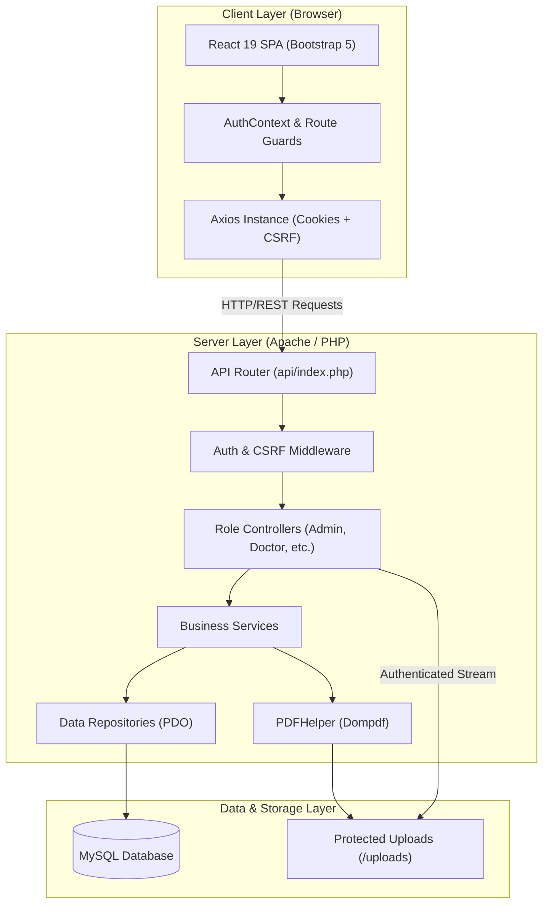

# 🏥 MedSync — Healthcare & Clinic Queue Management System

<div align="center">


[](https://uwumedsync.xo.je)


**A modern, secure, full-stack digital medical center management platform featuring automated queue allocation, appointment scheduling, digital prescription issuance, and Protected Health Information (PHI) access control.**

### 🌐 [**Visit Live Application: https://uwumedsync.xo.je**](https://uwumedsync.xo.je)

[Live Demo](https://uwumedsync.xo.je) • [Key Features](#-key-features) • [Architecture](#-architecture) • [Getting Started](#-getting-started) • [Security](#-security--compliance)

</div>

---

## 📖 Overview

> 🚀 **Live Deployment:** MedSync is actively deployed and accessible at **[https://uwumedsync.xo.je](https://uwumedsync.xo.je)**.

### 🔑 Demo Accounts for Live Testing

You can explore the live system as any user role using the following test credentials:

| Role | Email | Password | Access & Features |
|---|---|---|---|
| 🛡️ **Administrator** | `admin@uwu.ac.lk` | `password123` | Analytics, doctor schedules, user management, appointment windows |
| 🩺 **Doctor** | `doctor@uwu.ac.lk` | `password123` | Consultation queue, digital prescriptions & medical certificates |
| 📋 **Receptionist** | `receptionist@uwu.ac.lk` | `password123` | Walk-in booking, window queue tracking, proof document review |
| 🧑‍🎓 **Patient** | `patient@std.uwu.ac.lk` | `password123` | Book appointments, live queue tracking, medical requests & prescriptions |

**MedSync** streamlines medical operations for campus clinics, university health centres, and outpatient clinics. It bridges patients, doctors, receptionists, and medical administrators through real-time queue synchronization, verified medical certificates, digital prescription rendering, and health announcements.

---

## 🏛️ Architecture

MedSync implements a modern decoupled architecture:
- **Client Tier**: Single Page Application built with React 19, Vite, Bootstrap 5.3 (with Bootstrap Icons), SweetAlert2, React Router v7, and Axios.
- **API Tier**: PHP RESTful service utilizing a Controller-Service-Repository pattern with strict session authentication and CSRF token defense.
- **Persistence Tier**: MySQL/MariaDB database with ACID transactions, foreign keys, and indexes.
- **Document & Storage Tier**: Dompdf engine generating tamper-evident PDF certificates and prescriptions, backed by an authenticated file-streaming controller blocking direct HTTP access to PHI.



---

## ✨ Key Features

### 🧑‍🎓 Patient Portal
- **Streamlined Registration & OTP Verification**: University email validation and secure password management.
- **Appointment Booking**: Schedule appointments within active doctor windows with real-time queue number calculation.
- **Live Queue Tracking**: Monitor real-time queue position and doctor consultation progress.
- **Medical Certificate Requests**: Upload proof documents (JPG/PNG/PDF) and track certificate approval status.
- **Prescription Archive**: View and download digital prescriptions issued by attending physicians.

### 🩺 Doctor Portal
- **Consultation Queue Management**: Call next patient, mark as in-consultation, completed, or no-show.
- **Digital Prescription Creation**: Prescribe medications with automated dosages, schedules, and duration calculations.
- **Medical Certificate Issuance**: Approve, reject, or issue medical certificates with custom recommendations and embedded digital signatures.
- **Leave Management**: Schedule doctor leave with automated notification to affected clinic windows.
- **Health Feed**: Publish educational health posts and announcements for students.

### 📋 Receptionist Portal
- **Walk-in Quick Booking**: Rapid patient registration and window assignment for on-site patients.
- **Window Monitoring**: Overview of ongoing appointment windows and doctor attendance.
- **Certificate Verification**: Review submitted patient proof documents and medical requests.

### 🛡️ Administrator Portal
- **Analytics & Statistics**: System-wide appointment metrics, user counts, and patient demographics.
- **User Management**: Role assignment, account activation, password resets, and user blocking.
- **Appointment Window Setup**: Define operational clinic hours, session capacities, and assign doctors.
- **System Audit & Feedback**: Monitor patient feedback and manage educational health articles.

---

## 🛠️ Technology Stack

| Layer | Technologies |
|---|---|
| **Frontend** | React 19, Vite, Bootstrap 5.3, Bootstrap Icons, SweetAlert2, Axios, React Router v7 |
| **Backend** | PHP 8.1+, RESTful API, Layered Architecture (Controller-Service-Repository) |
| **Database** | MySQL 5.7+ / MariaDB 10.4+, PDO with Prepared Statements |
| **Document Engine** | Dompdf (Secure HTML-to-PDF generation with remote asset blocking) |
| **Security** | Role-Based Access Control (RBAC), CSRF Double-Submit tokens, Bcrypt hashing, `.htaccess` PHI isolation |
| **Dev Tools** | Git, Composer, npm, ESLint, GitHub Actions CI |

---

## 🚀 Getting Started

### Prerequisites

Ensure you have the following installed on your development machine:
- **PHP >= 8.1** (with `pdo_mysql`, `mbstring`, `gd`, `fileinfo` extensions enabled)
- **Composer** (PHP dependency manager)
- **Node.js >= 18.x** and **npm >= 9.x**
- **MySQL / MariaDB** (via XAMPP, Docker, or standalone)
- **Apache** (with `mod_rewrite` enabled)

---

### Step 1: Clone the Repository

```bash
git clone https://github.com/your-username/medsync.git
cd medsync
```

---

### Step 2: Database Setup

1. Start your MySQL service (e.g. via XAMPP Control Panel).
2. Create the database in MySQL:
   ```sql
   CREATE DATABASE medsync_db CHARACTER SET utf8mb4 COLLATE utf8mb4_general_ci;
   ```
3. Import the database schema:
   ```bash
   mysql -u root -p medsync_db < database/schema.sql
   ```
4. *(Optional)* Import starter roles and demo seed accounts:
   ```bash
   mysql -u root -p medsync_db < database/seeds.sql
   ```

---

### Step 3: Backend Configuration (`api/`)

1. Navigate to the API directory:
   ```bash
   cd api
   ```
2. Install PHP dependencies:
   ```bash
   composer install
   ```
3. Configure environment settings:
   - Copy `api/.env.example` to `api/.env` (or configure `api/config/database.php` directly):
   ```env
   DB_HOST=localhost
   DB_NAME=medsync_db
   DB_USER=root
   DB_PASS=
   ```
4. Verify directory permissions:
   Ensure `api/uploads/` and its subdirectories (`generated_pdfs/`, `medical_proofs/`, `profiles/`, `signatures/`) are writable by the web server.

---

### Step 4: Frontend Configuration (`frontend/`)

1. Open a new terminal and navigate to the frontend directory:
   ```bash
   cd frontend
   ```
2. Install Node dependencies:
   ```bash
   npm install
   ```
3. Configure environment:
   - Copy `frontend/.env.example` to `frontend/.env`:
   ```env
   VITE_API_URL=http://localhost/medsync/api
   ```
4. Start the development server:
   ```bash
   npm run dev
   ```
5. Open your browser and navigate to `http://localhost:5173`.

---

## 🔒 Security & Compliance

MedSync is engineered with healthcare data privacy and application security standards:

1. **Protected Health Information (PHI) Shielding**:
   - `api/uploads/generated_pdfs/` and `api/uploads/medical_proofs/` contain dedicated `.htaccess` rules (`Deny from all`) preventing direct URL access.
   - All files are streamed through [CertificateController::download_file()](file:///c:/xampp/htdocs/medsync/api/controllers/CertificateController.php) which verifies active session authentication and ownership permissions before delivery.
2. **Path Traversal & Injection Prevention**:
   - Filenames are strictly sanitized to alphanumeric characters.
   - Dynamic user input in PDF templates is safely escaped using `htmlspecialchars()`.
   - External resource loading in Dompdf is strictly disabled (`setIsRemoteEnabled(false)`).
3. **Double Queue Protection**:
   - Queue slots are assigned using `MAX(queue_number) + 1` with pessimistic database row locking (`FOR UPDATE`) to prevent duplicate queue numbers during concurrent bookings.
4. **Cross-Site Request Forgery (CSRF)**:
   - Protected endpoints require an `X-CSRF-Token` header matched against session tokens.
5. **SQL Injection Defense**:
   - 100% of SQL queries utilize parameterized PDO prepared statements.

---

## 📂 Project Structure

```text
medsync/
├── 📁 .github/              # CI/CD workflows and issue/PR templates
├── 📁 api/                  # PHP REST API backend
│   ├── 📁 config/           # Database connection & interface
│   ├── 📁 controllers/      # HTTP request dispatchers
│   ├── 📁 exceptions/       # Custom application exceptions
│   ├── 📁 helpers/          # PDF, Email, Upload & Response helpers
│   ├── 📁 middleware/       # Auth & CSRF filters
│   ├── 📁 repositories/     # Data access layer (PDO)
│   ├── 📁 services/         # Business logic layer
│   ├── 📁 uploads/          # Upload storage (PHI secured)
│   ├── 📁 validators/       # Input validation classes
│   ├── 📄 composer.json     # Backend dependencies
│   └── 📄 index.php         # Main routing entrypoint
├── 📁 database/             # SQL schema and seed files
│   ├── 📄 schema.sql        # Complete DDL tables and constraints
│   └── 📄 seeds.sql         # Default roles and test users
├── 📁 frontend/             # React 18 + Vite frontend SPA
│   ├── 📁 src/
│   │   ├── 📁 api/          # Axios HTTP client configuration
│   │   ├── 📁 components/   # Shared UI components
│   │   ├── 📁 context/      # AuthContext state provider
│   │   ├── 📁 hooks/        # Custom React hooks
│   │   ├── 📁 pages/        # Patient, Doctor, Receptionist & Admin views
│   │   ├── 📁 services/     # API consumer services
│   │   └── 📁 utils/        # Formatters and validators
│   ├── 📄 package.json      # Node.js dependencies
│   └── 📄 vite.config.js    # Vite configuration
├── 📄 .gitignore            # Root ignore rules for Git
├── 📄 LICENSE               # MIT License
├── 📄 README.md             # Project documentation
└── 📄 SECURITY.md           # Security disclosure policy
```

---

## 📜 License

This project is licensed under the MIT License — see the [LICENSE](LICENSE) file for details.
